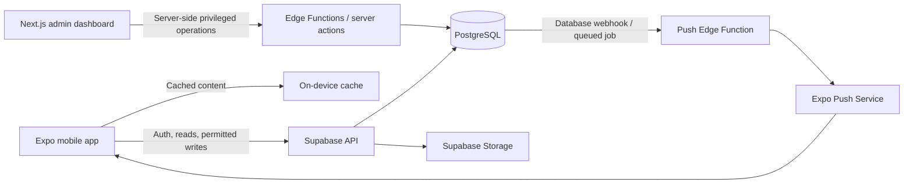

# KAMUN 2026 Conference App Architecture

## Product and assumptions

KAMUN needs a mobile companion for delegates, chairs, and organisers during the 13–15 November 2026 conference at Karlsruhe Institute of Technology. The app should make the live programme, committee information, documents, venue guidance, and urgent updates easy to reach during a busy three-day event.

The first release is a KAMUN-specific product. Every content record still carries a `conference_id`, so later editions can reuse the same system without committing now to a full multi-tenant conference platform.

Planning assumptions:

- Approximately 180 delegates plus chairs and staff.
- English is the primary app language. Content can be made translation-ready without translating the first release.
- Delegates should not need to create an email/password account.
- Chairs and organisers require verified accounts.
- The app must remain useful with weak venue connectivity.
- The website or MyMUN remains the application and payment system; this app begins after a participant has been accepted.
- Committee names, rooms, contacts, and the final timetable will be imported from an organiser-approved source before launch.

## Users and core flows

| User | Main actions |
| --- | --- |
| Delegate | Select or claim an assignment, view a personal schedule, open study guides, receive updates, find rooms, contact welfare staff, and later submit logistics requests or memes |
| Chair | Use the delegate features, see chair-specific documents and notices, and submit committee logistics requests |
| Secretariat and logistics staff | Publish updates, manage content, receive and resolve requests, and moderate user-generated content |
| Administrator | Configure the conference, grant staff roles, manage permissions, and review the audit trail |

The normal delegate path is: install → anonymous device sign-in → enter an invitation code or select an allowed committee/assignment → see a personalised home screen → use schedule, updates, resources, venue, and emergency information.

Staff use the web dashboard for content management. The mobile app may expose a compact staff request queue later, but it should not become the primary admin interface.

## Scope

### Release 1: reliable conference companion

1. Device-based onboarding and committee assignment
2. Personalised home screen
3. Committee-aware, offline-cached schedule
4. Announcements with audience targeting
5. Resource library with downloadable documents
6. KIT venue locations, rooms, and external directions
7. Emergency, welfare, and safe-space contacts
8. Settings, notification preferences, and assignment reset
9. Web dashboard for all of the above

### Release 1.1: live operations

1. Push notifications
2. Logistics requests with statuses and assignment to staff
3. Chair- and staff-only notices
4. CSV import/export for schedules, committees, and assignments
5. Operational dashboard showing unresolved requests and failed notifications

### Release 1.2: social features

1. Moderated meme feed
2. Reports, takedowns, and committee leaderboard
3. Conference gallery
4. Secretariat and sponsor profiles

The meme feed should ship only when reporting, moderation, terms, and a staffed response process are ready. It should not delay the operational MVP.

## Recommended stack

| Area | Choice | Reason |
| --- | --- | --- |
| Mobile | Expo, React Native, TypeScript | One iOS/Android codebase, mature notification and build tooling |
| Navigation | Expo Router | File-based routes and deep links for notifications |
| Server data | TanStack Query with persisted cache | Clear loading/error behavior and offline access to recently synced conference data |
| Local preferences | Expo SecureStore for identifiers; AsyncStorage for non-sensitive cache | Keeps identity material separate from ordinary cached content |
| Backend | Supabase PostgreSQL, Auth, Storage, Realtime, Edge Functions | Fits the event size and keeps the operational surface small |
| Admin | Next.js, TypeScript, shadcn/ui | Efficient data-heavy forms and tables; simple Vercel deployment |
| Push | Expo Notifications and Expo Push Service | Shared notification path for iOS and Android |
| Maps | React Native Maps plus external Apple/Google Maps links | Familiar venue map without building navigation |
| Validation | Zod shared between clients and server operations | One definition for form and API validation |
| Monitoring | Sentry for mobile/admin; Supabase logs | Captures release and runtime failures during the conference |
| Builds | EAS Build and EAS Update | Repeatable store builds and safe JavaScript-only fixes |

Avoid using Realtime for every table. Schedule and document changes can refetch after an announcement or app foreground event. Use Realtime only where seconds matter, initially announcements and logistics request status.

## System architecture



Public conference content is read through Supabase under Row Level Security. Privileged actions such as granting roles, publishing targeted notifications, bulk imports, and moderation use server-side functions with explicit permission checks and audit records. The service-role key never appears in either client application.

The mobile app performs an initial sync, persists the latest published content, and shows a visible “last updated” state. Emergency contacts and the user’s current-day schedule must be available offline.

## Data model

All IDs are UUIDs. All mutable tables include `created_at` and `updated_at` timestamps. Published content supports `status` (`draft`, `published`, `archived`) where relevant.

| Table | Important fields and constraints |
| --- | --- |
| `conferences` | `id` PK, `slug` unique, `name`, `theme`, `starts_at`, `ends_at`, `timezone`, `venue_name`, `status` |
| `profiles` | `id` PK/FK → `auth.users.id`, `display_name`, `locale`; no user-editable privileged role |
| `conference_memberships` | `conference_id` FK, `user_id` FK, `role` (`delegate`, `chair`, `staff`, `admin`), `committee_id` nullable FK, `assignment_label`, unique `(conference_id,user_id)` |
| `invite_codes` | `conference_id`, hashed `code`, intended `role`, optional `committee_id`, `max_uses`, `expires_at`, `revoked_at`; never store plaintext after creation |
| `committees` | `id`, `conference_id`, `name`, `abbreviation`, `topic`, `difficulty`, `room_id`, `color`, unique `(conference_id, abbreviation)` |
| `venues` | `id`, `conference_id`, `name`, `address`, `latitude`, `longitude`, `map_image_url` |
| `rooms` | `id`, `venue_id`, `name`, `floor`, `directions`, unique `(venue_id,name)` |
| `schedule_events` | `id`, `conference_id`, optional `committee_id`, `title`, `description`, `starts_at`, `ends_at`, optional `room_id`, `event_type`, `audience_roles[]`, check `ends_at > starts_at` |
| `announcements` | `id`, `conference_id`, `title`, `body`, `priority`, `published_at`, `expires_at`, `author_id`, `audience_roles[]` |
| `announcement_committees` | `announcement_id`, `committee_id`, composite PK; an empty set means all committees |
| `resources` | `id`, `conference_id`, optional `committee_id`, `title`, `kind`, `storage_path` or approved external URL, `audience_roles[]`, `sort_order` |
| `locations` | `id`, `conference_id`, `name`, `category`, `address`, `latitude`, `longitude`, `description`, `external_maps_url` |
| `emergency_contacts` | `id`, `conference_id`, `label`, `person_name`, `role`, `phone`, `email`, `is_emergency`, `sort_order` |
| `push_devices` | `id`, `user_id`, `conference_id`, `expo_push_token` unique, `platform`, `enabled`, `last_seen_at` |
| `notification_preferences` | `user_id`, `conference_id`, `general_enabled`, `committee_enabled`, `logistics_enabled`, composite PK |
| `logistics_requests` | `id`, `conference_id`, `requester_id`, `committee_id`, `room_id`, `type`, `message`, `status`, `assigned_to`, `resolved_at` |
| `logistics_request_events` | `id`, `request_id`, `actor_id`, `from_status`, `to_status`, `note`; immutable history |
| `meme_posts` | `id`, `conference_id`, `author_id`, `committee_id`, `image_path`, `caption`, `moderation_status`, `created_at`, `deleted_at` |
| `meme_votes` | `post_id`, `voter_id`, unique `(post_id,voter_id)` |
| `meme_reports` | `id`, `post_id`, `reporter_id`, `reason`, `status`, unique open report per reporter/post |
| `people` | `id`, `conference_id`, `name`, `title`, `bio`, `photo_path`, `contact_visibility`, `sort_order` |
| `sponsors` | `id`, `conference_id`, `name`, `logo_path`, `website_url`, `tier`, `sort_order` |
| `gallery_photos` | `id`, `conference_id`, `storage_path`, `caption`, `published_at`, `photographer_credit` |
| `audit_logs` | `id`, `conference_id`, `actor_id`, `action`, `entity_type`, `entity_id`, limited metadata JSON, `created_at`; append-only |

Important indexes:

- `schedule_events(conference_id, starts_at)` and `(committee_id, starts_at)`
- `announcements(conference_id, published_at desc)`
- `resources(conference_id, committee_id, sort_order)`
- `logistics_requests(conference_id, status, created_at)`
- `meme_posts(conference_id, moderation_status, created_at desc)`
- `conference_memberships(user_id, conference_id)`

## Identity, permissions, and RLS intent

Supabase anonymous authentication creates a real `auth.uid()` for an attendee without requesting email credentials. An invite code can attach the correct committee and role. If open committee selection is preferred, only the `delegate` role may be self-selected; chair and staff roles always require a code or admin grant.

RLS policies should enforce these rules:

- Users can read published content for an active conference. Draft content is limited to staff.
- Users can read and update their own profile and notification preferences.
- Users cannot directly create or alter staff/admin memberships.
- Delegates see their own membership and their own logistics requests.
- Chairs see logistics requests for their assigned committee if KAMUN chooses that workflow.
- Staff see and update requests within the conference; status changes also create immutable history.
- Only staff/admin users can create or publish schedules, announcements, resources, contacts, and locations.
- A meme author can create and soft-delete their own post. Moderators can hide any post. Public reads return only approved or unflagged visible posts.
- Storage policies mirror database ownership and MIME/size limits. Meme upload paths include both conference ID and `auth.uid()`.
- Role checks derive from `conference_memberships`, never from client-provided role strings or editable profile fields.

Admin authentication should use email magic links or an identity provider, require MFA for administrators, and use short sessions on shared devices. Every publish, role grant, import, and moderation action should be recorded in `audit_logs`.

## Server operations

Ordinary reads can use the generated Supabase client. Use Edge Functions or protected Next.js server actions for operations that require transactions, secrets, or privileged fan-out.

| Operation | Caller | Input | Result and rules |
| --- | --- | --- | --- |
| `claim-invite` | Signed-in anonymous or regular user | Conference slug, plaintext invite code | Atomically validates usage/expiry and creates membership; rate limited |
| `publish-announcement` | Staff/admin | Content, priority, role/committee audiences, push flag | Publishes in a transaction, creates audit entry, optionally queues push sends |
| `import-schedule` | Admin | Validated CSV | Dry-run validation first; transactional upsert after confirmation; returns row errors |
| `create-logistics-request` | Member | Committee, room, type, message | Creates request under caller identity and notifies eligible staff |
| `transition-logistics-request` | Assigned staff/admin | Request ID, target status, optional note | Validates state transition and appends history |
| `moderate-meme` | Moderator/admin | Post ID, action, reason | Hides/restores content and records audit event |
| `register-push-device` | Member | Expo token, platform, preferences | Upserts only for the caller; validates token format |
| `send-targeted-push` | System/staff | Announcement ID | Resolves recipients server-side, sends in batches, stores delivery receipts/errors |

Push delivery is best effort. Every important notice also remains in the in-app announcement feed.

## Mobile screens

| Screen | Purpose and main content |
| --- | --- |
| Welcome and assignment | Conference identity, attendee name, invite/committee flow, privacy notice |
| Home | Current/next session, newest important announcement, committee and room, quick actions, conference countdown before opening |
| Schedule | Day tabs, current-time indicator, personal committee filter, event details, offline status |
| Updates | Priority-labelled announcement feed and details |
| Resources | General and committee documents, download/open state, document metadata |
| Venue | KIT venue/room list, map markers, room directions, external map launch |
| Emergency and welfare | Offline phone numbers, safe-space contacts, tap-to-call with confirmation |
| Logistics request | Request type, room, short description, current status and history; phase 1.1 |
| Meme feed | Feed, upload, report, own-post deletion, community rules; phase 1.2 |
| More | Secretariat, sponsors, gallery, app information |
| Settings | Assignment summary, notification preferences, privacy information, clear local data/reset |

Reusable mobile components include `CurrentSessionCard`, `AnnouncementBanner`, `DaySchedule`, `EventRow`, `CommitteeBadge`, `OfflineStatus`, `ResourceRow`, `LocationCard`, `EmergencyContactCard`, and `EmptyState`.

## Admin dashboard

The dashboard should provide:

- Conference overview with draft/published status and readiness checks
- Committee, venue, and room management
- Schedule editor plus CSV dry-run/import
- Announcement composer with audience preview and optional push
- Resource and file management
- Location and emergency-contact management
- Membership and staff-role management
- Logistics queue with filters, ownership, and status history
- Meme moderation and report queue when the feature launches
- Audit trail and basic notification delivery results

The dashboard should show exactly how many users a targeted announcement will reach before publishing. Destructive content actions use soft deletion where practical.

## Repository structure

```text
kamun-app/
├── apps/
│   ├── mobile/                 # Expo Router application
│   │   ├── app/                # Routes and layouts
│   │   └── src/
│   │       ├── components/
│   │       ├── features/
│   │       ├── lib/
│   │       └── theme/
│   └── admin/                  # Next.js dashboard
│       ├── app/
│       └── src/
│           ├── components/
│           ├── features/
│           └── server/
├── packages/
│   ├── contracts/              # Zod schemas and domain types
│   ├── database/               # Generated Supabase types and shared queries
│   └── config/                 # Shared TypeScript/lint configuration
├── supabase/
│   ├── migrations/
│   ├── functions/
│   └── seed.sql
└── docs/
    ├── data-imports.md
    └── release-runbook.md
```

Keep mobile and admin UI components separate. Share contracts and database types, not web/native presentation code.

## Build order

### Milestone 1: product foundation

1. Confirm KAMUN branding, committee list, venue/room data, schedule ownership, emergency contacts, and privacy owner.
2. Create the monorepo, environments, Supabase projects, migrations, generated types, CI checks, and seed data.
3. Implement anonymous attendee auth, authenticated admin auth, invite claims, memberships, and RLS tests.

### Milestone 2: offline attendee core

4. Build onboarding, app shell, home, personalised schedule, and persisted data cache.
5. Add announcements, resources, venue/room guidance, emergency contacts, and settings.
6. Add loading, empty, expired-conference, offline, and failed-sync states.

### Milestone 3: organiser control

7. Build admin CRUD for conference content and storage uploads.
8. Add schedule CSV dry-run/import, publishing workflow, audience preview, and audit logging.
9. Rehearse a schedule change and urgent announcement from dashboard to two physical test devices.

### Milestone 4: release readiness

10. Add push registration and targeted delivery, accessibility checks, error monitoring, privacy copy, and data-retention jobs.
11. Run role/RLS tests, poor-network tests, timezone tests, device testing, TestFlight, and Android internal testing.
12. Prepare store listings, support contact, admin runbook, incident contacts, and a rollback procedure.

### Milestone 5: optional operations and social features

13. Add logistics requests only after the staff workflow and ownership rules are agreed.
14. Add memes only after moderation policy, reporting, staffing, and store-compliance requirements are complete.

## Material risks and decisions

| Risk or decision | Consequence | Recommendation |
| --- | --- | --- |
| Anonymous identity is lost after uninstall | A user can lose ownership of requests or posts | Use invite re-claim rules or an optional recovery code; avoid storing critical identity only in local preferences |
| Open committee selection can expose role-only content | Users may impersonate chairs/staff | Allow open selection only for delegate personalisation; grant privileged roles by code/admin |
| Venue connectivity is weak | Schedule and emergency information may fail at the moment it is needed | Persist published data and files where permitted; show last sync time and retry controls |
| Schedule source is unclear | Organisers may edit competing copies | Make the dashboard/import pipeline the operational source of truth and name one schedule owner |
| Push notifications fail or arrive late | Attendees miss changes | Keep every alert in-app and show high-priority banners; treat push as an extra delivery channel |
| Meme moderation is understaffed | Harmful content and store-review problems | Delay launch, publish community rules, add report/hide tools, and name on-call moderators |
| Personal data retention is undefined | GDPR and trust risk | Document purpose and retention per data class; automatically remove event-only data on the approved schedule |
| Last-minute over-the-air update causes regression | Conference app breaks during the event | Freeze features before the conference; permit only reviewed fixes with rollback available |

## Delivery expectation

A reliable MVP is achievable in roughly three to five focused weeks if KAMUN supplies content and decisions promptly. Reserve at least one additional week before the conference for physical-device testing, organiser rehearsal, store review contingency, and bug fixing. Logistics and memes should be separate acceptance milestones rather than conditions for the first store release.

## Next coding task

Create the monorepo and the first Supabase migration for `conferences`, `profiles`, `conference_memberships`, `invite_codes`, `committees`, `venues`, `rooms`, and `schedule_events`. Add seed data for KAMUN 2026 and RLS tests proving that an anonymous delegate can read published schedule data but cannot grant themselves a chair, staff, or admin role.
